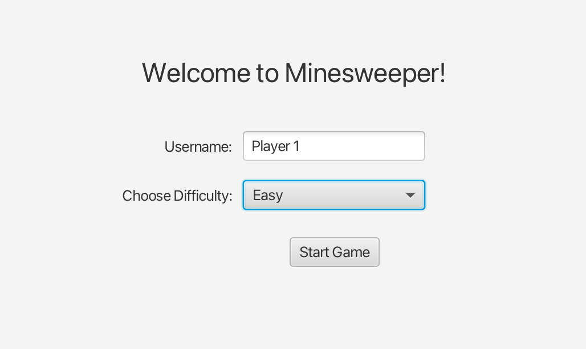
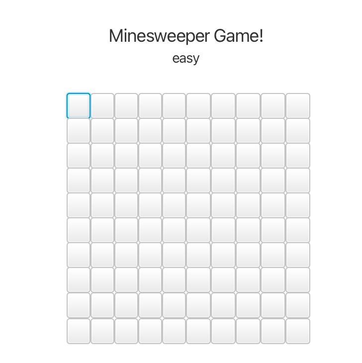
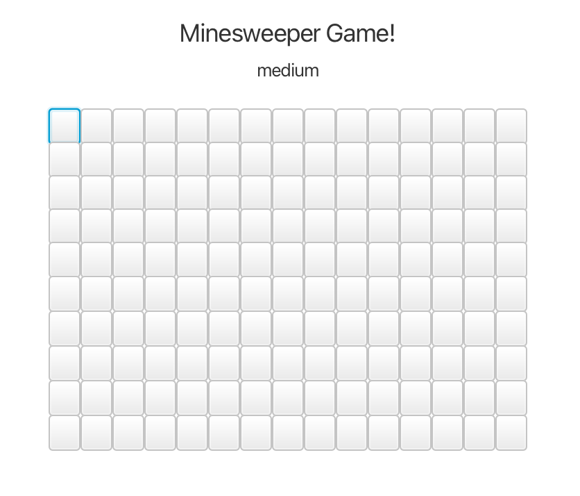
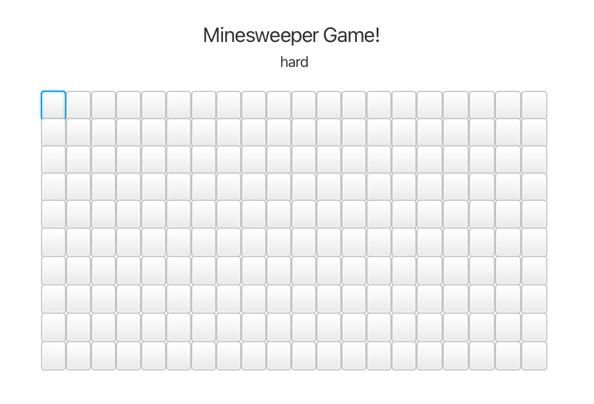
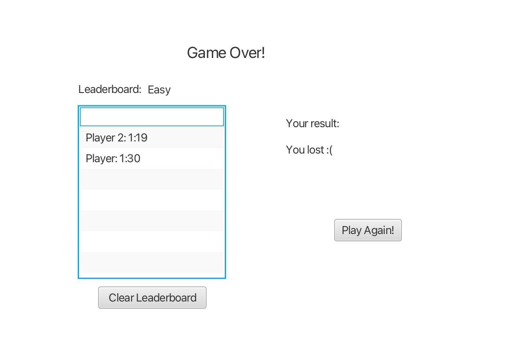
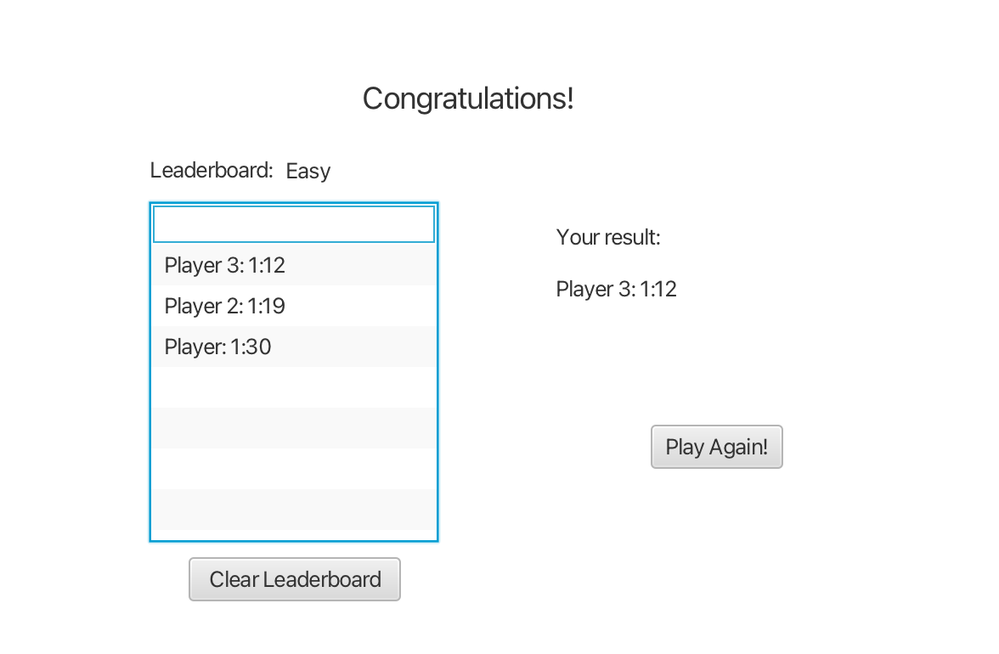

# Minesweeper

A JavaFX implementation of the classic logic puzzle game, created for an Object-Oriented Programming course (TDT4100). It recreates the core gameplay of Minesweeper, with a name entry, selectable difficulty levels, and a persistent leaderboard. 

To run the game, see [Setup and Installation](#setup-and-installation) and [Running the App](#running-the-app).

## Features

- Three difficulty levels.
- Classic Minesweeper gameplay: open all safe tiles to win. 
- Leaderboard of previous results, with the option to clear it. 
- Start a new game directly from the end screen. 

## Playthrough

**Starting page**
When the application opens, you are asked to enter a name and choose a difficulty level. If either field is empty, a warning popup tells you that all fields must be filled in.



| Difficulty | Grid size | Bombs |
|---|---|---|
| Easy | 10x10 | 10 |
| Medium | 20x15 | 25 |
| Hard | 25x20 | 40 |

**Gameplay**
Starting a game opens a new window showing the title, the difficulty, and the grid of tiles. As in the traditional game, you win by opening all safe tiles, and you lose if you open a tile containing a bomb.





**Differences from the original game:**

- The first click is not guaranteed to be safe.
- Opening a tile with no neighboring bombs does not automatically open its adjacent tiles, even if they are also zeros.

**End screen**
The title depends on the result: you are either congratulated or told the game is over. The screen also shows a leaderboard of all saved results from previous games. From here you can clear the leaderboard or start a new game.




## Requirements

- **Java JDK 21** or newer.
- **Apache Maven 3.9** or newer.

Verify your installation: 

```bash
java -version
mvn -version
```

Both should report Java 21 or higher.

## Setup and Installation

1. Clone the repository:
   ```bash
   git clone https://github.com/jhohannah/minesweeper.git
   cd minesweeper
   ```
2. Make sure you are running JDK 21 or newer. If you use [SDKMAN](https://sdkman.io/), run `sdk install java 21.0.8-tem`. Otherwise, download JDK 21 from [Adoptium](https://adoptium.net/) and make sure `JAVA_HOME` points to it.
3. Build the project:
   ```bash
   mvn clean compile
   ```

## Running the App

From the project root:

```bash
mvn javafx:run
```

## Dependencies

Managed automatically by Maven (see `pom.xml`). No manual downloads are needed. 

| Dependency | Version | Purpose |
|---|---|---|
| `javafx-base`, `javafx-graphics`, `javafx-controls` | 23.0.2 | JavaFX UI toolkit |
| `javafx-fxml` | 23.0.2 | FXML layout files |
| `junit-jupiter-engine` | 5.10.1 | Unit testing |
| `javafx-maven-plugin` | 0.0.8 | Running the app with `mvn javafx:run` |
